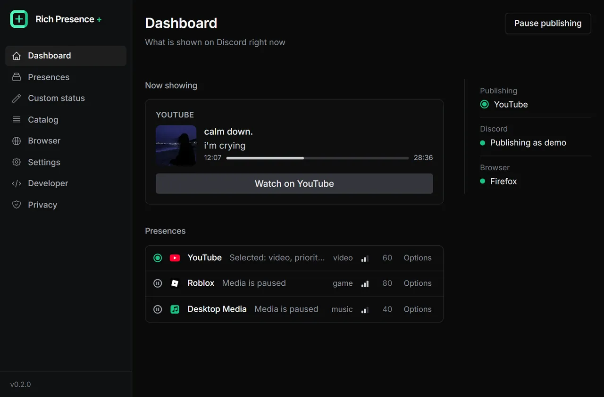

<p align="center">

</p>


<h1 align="center">Rich Presence Plus</h1>

<div align="center">
    
    
    
    
    
    
</div>


<p align="center">
A simple Discord Rich Presence (Discord RPC) application manager for custom desktop or web services statuses.
</p>

<p align="center">
Shows what you're doing on the <b>web</b> or <b>desktop</b> in Discord.
</p>



> [!IMPORTANT]  
> Rich Presence Plus is moving from Python to Rust. This branch holds the new version, written from scratch with Rust and Tauri, and it has not had its first release yet. The Python version lives in the [`old-rpp`](https://github.com/manucabral/RichPresencePlus/tree/old-rpp) branch.

> Only compatible with Microsoft Windows systems.

# Download
The new version has no release yet. The installers of the Python version are [here](https://github.com/manucabral/RichPresencePlus/releases).

# Features
- Easy to use.
- Support for multiple presences.
- Compatibility with web and desktop presences.
- Users can create custom presences.
- Custom statuses, and profiles to switch between sets of rules.
- Download and use presences from a reviewed catalog.
- Privacy rules: hide sites, programs, titles or buttons, and pause everything at once.
- English and Spanish.

# Supported browsers
- Chromium browsers (Chrome, Edge, Brave, Opera and others).
- Mozilla Firefox.

If you want support for another browser or find a bug, create an [issue](https://github.com/manucabral/RichPresencePlus/issues/new/choose).

## Request a Presence
If you'd like to propose a new web or desktop presence to be added to the list, please [create an issue](https://github.com/manucabral/RichPresencePlus/issues/new/choose).

You can check the development status of each one by going [here](https://github.com/users/manucabral/projects/4).

## Presence Development
Presences are written in JavaScript. Read the [developer documentation](docs/developers/en/01-home.md) ([en español](docs/developers/es/01-home.md)) to start coding your custom presence, and [docs/CATALOG.md](docs/CATALOG.md) to see how one gets into the catalog.

All presences are accepted as long as they follow the correct policies.

## Build from source
The application is written in Rust with Tauri, and the window in Preact. You need Rust (stable), Node.js with pnpm, and the Tauri CLI (`cargo install tauri-cli`).

```
pnpm --dir frontend install
cargo tauri dev
```

To build the installer:

```
cargo tauri build
```

Before sending a change, `cargo fmt --check`, `cargo clippy --all-targets` and `cargo test` must pass. [docs/DEVELOPING.md](docs/DEVELOPING.md) has the details and [CONTRIBUTING.md](CONTRIBUTING.md) explains how changes are reviewed.

## Discussions
If you have questions, feature suggestions, or feedback to share, the Discussions area is the best place to engage with the community.

Feel free to start a new discussion [here](https://github.com/manucabral/RichPresencePlus/discussions).

## Discord
Join our community on Discord to connect with other users, get support, and share your ideas. Stay updated with the latest news, participate in discussions, and collaborate with fellow developers.

[Join our Discord server](https://discord.gg/NjXFRqWarc)

## RoadMap
- Finish the move to Rust and publish the first release, with a signed installer and in-app updates.
- The browser extension in the Chrome, Edge and Firefox stores.
- More presences in the catalog.
- More languages, starting with Portuguese and Russian.

## Contributors
People who maintain or help with the application.

<a href="https://github.com/manucabral/richpresenceplus/graphs/contributors">
  
</a>

Made with [contrib.rocks](https://contrib.rocks).
