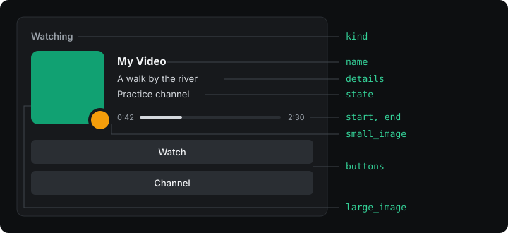

# Script

A script defines functions and the application calls them. It never calls them itself and
never talks to Discord. `read` and `activity` are required; `meta` is optional. Every
`interval` seconds the application calls `read`, then `activity` and `meta` with what `read`
returned. When `read` returns `null`, the round ends there.

A script is one file of plain JavaScript. It cannot `import` other files, and it has no
`fetch`, `URL` or DOM. What it can use besides the language is in [Helpers](12-helpers.md) and
[Host](11-host.md). Variables outside the functions keep their values between calls.

## read(context)

Looks at the world and returns what the presence needs, or `null` when there is nothing to show.

```js
function read(context) {
  const page = bestPage(context.pages);
  if (!page) return null;
  return { title: page.title, opened: context.now };
}
```

| Field of `context` | Type | What it holds |
| --- | --- | --- |
| `now` | number | The time, in Unix seconds. |
| `pages` | list of pages | Pages of the browser that match this presence. Empty for a desktop presence. |
| `options` | object | The value of each option, or its default. |

| Field of a page | Type | What it holds |
| --- | --- | --- |
| `url` | text | Full address of the page. |
| `title` | text | Title of the tab. |
| `received_at` | number | When it was read, in Unix milliseconds. |
| `values` | object | What the manifest asks to read, under each name. See [Extractors](09-extractors.md). |

**Returns** a plain object of up to 64 KB, or `null`. Only data passes: functions are dropped.

## activity(seen)

Turns what `read` returned into the card. Every field is optional, but the card needs at
least a text or an image.

```js
function activity(video) {
  return {
    name: "My Video",
    details: cut(video.title),
    state: video.channel,
    kind: "watching",
    start: video.start,
    end: video.end,
    buttons: [{ label: t("watch"), url: video.url }],
  };
}
```



| Field | Type | What it does |
| --- | --- | --- |
| `name` | text | Title of the activity, in place of the Discord application's name. |
| `details` | text | First line. |
| `state` | text | Second line. |
| `kind` | `playing`, `listening`, `watching` or `competing` | The word before the name. `playing` when missing. |
| `start` | number | Unix seconds. Alone, the time counts up from it. |
| `end` | number | Unix seconds. With `start`, it draws a progress bar. |
| `large_image` | text | An `https://` address, or the name of an image of your Discord application. |
| `large_text` | text | Shown when hovering the large image. |
| `small_image` | text | Small picture in the corner of the large one. Same values as `large_image`. |
| `small_text` | text | Shown when hovering the small image. |
| `buttons` | list | Up to two `{ label, url }`. |
| `details_url` | text | Address opened when clicking the first line. |
| `state_url` | text | Address opened when clicking the second line. |
| `large_url` | text | Address opened when clicking the large image. |
| `small_url` | text | Address opened when clicking the small image. |
| `party_size` | `[current, largest]` | Shown as "(2 of 4)". |
| `status_display` | `name`, `state` or `details` | Which text the member list shows next to the person's name. |

Texts take 2 to 128 characters; a shorter one is dropped, a longer one is an error, and
[`cut`](12-helpers.md#cuttext-max) keeps them inside the limit. Addresses are `http://` or
`https://`, up to 512 characters, without a user or password. A button label takes 1 to 32
characters. `end` cannot be earlier than `start`. `party_size` goes from 1 to 1000, and
`current` cannot be larger than `largest`.

## meta(seen)

Tells the application facts Discord does not show. It helps choose between presences and apply
the privacy rules.

```js
function meta(video) {
  return { paused: !video.playing };
}
```

| Field | Type | What it does |
| --- | --- | --- |
| `paused` | boolean | A paused presence gives way to one that plays, and hides unless `hide_when_paused` is `false`. |
| `foreground` | boolean | Raises the presence while its window has focus. |
| `application` | text | Program name, so people can exclude it in Privacy. |
| `domains` | list of texts | Extra sites, so people can exclude them in Privacy. |

## Keep something between calls

A variable declared outside the functions keeps its value. That is how a script remembers when
something started:

```js
let since = 0;

function read(context) {
  const running = host.process.list().includes("game.exe");
  if (!running) {
    since = 0;
    return null;
  }
  if (since === 0) since = context.now;
  return { since };
}
```

A presence that is turned off or reloaded starts again from zero.
