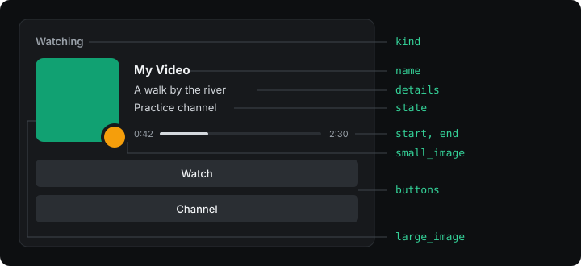

# Script

Un script define funciones y la aplicación las llama. Nunca se llaman solas ni hablan con
Discord. `read` y `activity` son obligatorias; `meta` es opcional. Cada `interval` segundos la
aplicación llama a `read`, y después a `activity` y `meta` con lo que devolvió `read`. Cuando
`read` devuelve `null`, la vuelta termina ahí.

Un script es un solo archivo de JavaScript común. No puede hacer `import` de otros archivos, y no
tiene `fetch`, `URL` ni DOM. Lo que puede usar además del lenguaje está en
[Ayudantes](12-helpers.md) y [Host](11-host.md). Las variables fuera de las funciones conservan
su valor entre llamadas.

## read(context)

Mira el mundo y devuelve lo que necesita la presencia, o `null` cuando no hay nada para mostrar.

```js
function read(context) {
  const page = bestPage(context.pages);
  if (!page) return null;
  return { title: page.title, opened: context.now };
}
```

| Campo de `context` | Tipo | Qué tiene |
| --- | --- | --- |
| `now` | número | La hora, en segundos Unix. |
| `pages` | lista de páginas | Páginas del navegador que coinciden con esta presencia. Vacía en una presencia de escritorio. |
| `options` | objeto | El valor de cada opción, o su valor por defecto. |

| Campo de una página | Tipo | Qué tiene |
| --- | --- | --- |
| `url` | texto | Dirección completa de la página. |
| `title` | texto | Título de la pestaña. |
| `received_at` | número | Cuándo se leyó, en milisegundos Unix. |
| `values` | objeto | Lo que el manifiesto pide leer, bajo cada nombre. Mirá [Extractores](09-extractors.md). |

**Devuelve** un objeto común de hasta 64 KB, o `null`. Solo pasan datos: las funciones se descartan.

## activity(seen)

Convierte lo que devolvió `read` en la tarjeta. Todos los campos son opcionales, pero la tarjeta
necesita al menos un texto o una imagen.

```js
function activity(video) {
  return {
    name: "Mi Video",
    details: cut(video.title),
    state: video.channel,
    kind: "watching",
    start: video.start,
    end: video.end,
    buttons: [{ label: t("watch"), url: video.url }],
  };
}
```



| Campo | Tipo | Qué hace |
| --- | --- | --- |
| `name` | texto | Título de la actividad, en lugar del nombre de la aplicación de Discord. |
| `details` | texto | Primera línea. |
| `state` | texto | Segunda línea. |
| `kind` | `playing`, `listening`, `watching` o `competing` | La palabra antes del nombre. `playing` si falta. |
| `start` | número | Segundos Unix. Solo, el tiempo cuenta hacia arriba desde ahí. |
| `end` | número | Segundos Unix. Con `start`, dibuja una barra de progreso. |
| `large_image` | texto | Una dirección `https://`, o el nombre de una imagen de tu aplicación de Discord. |
| `large_text` | texto | Se muestra al pasar el mouse por la imagen grande. |
| `small_image` | texto | Imagen chica en la esquina de la grande. Los mismos valores que `large_image`. |
| `small_text` | texto | Se muestra al pasar el mouse por la imagen chica. |
| `buttons` | lista | Hasta dos `{ label, url }`. |
| `details_url` | texto | Dirección que se abre al hacer clic en la primera línea. |
| `state_url` | texto | Dirección que se abre al hacer clic en la segunda línea. |
| `large_url` | texto | Dirección que se abre al hacer clic en la imagen grande. |
| `small_url` | texto | Dirección que se abre al hacer clic en la imagen chica. |
| `party_size` | `[actual, máximo]` | Se muestra como "(2 de 4)". |
| `status_display` | `name`, `state` o `details` | Qué texto muestra la lista de miembros junto al nombre de la persona. |

Los textos llevan de 2 a 128 caracteres; uno más corto se descarta, uno más largo es un error, y
[`cut`](12-helpers.md#cuttext-max) los mantiene dentro del límite. Las direcciones son `http://`
o `https://`, de hasta 512 caracteres, sin usuario ni contraseña. La etiqueta de un botón lleva
de 1 a 32 caracteres. `end` no puede ser anterior a `start`. `party_size` va de 1 a 1000, y el
actual no puede ser mayor que el máximo.

## meta(seen)

Le cuenta a la aplicación datos que Discord no muestra. Ayuda a elegir entre presencias y a
aplicar las reglas de privacidad.

```js
function meta(video) {
  return { paused: !video.playing };
}
```

| Campo | Tipo | Qué hace |
| --- | --- | --- |
| `paused` | booleano | Una presencia en pausa le deja lugar a una que suena, y se oculta salvo que `hide_when_paused` sea `false`. |
| `foreground` | booleano | Sube la presencia mientras su ventana tiene el foco. |
| `application` | texto | Nombre del programa, para que la gente pueda excluirlo en Privacidad. |
| `domains` | lista de textos | Sitios extra, para que la gente pueda excluirlos en Privacidad. |

## Guardar algo entre llamadas

Una variable declarada fuera de las funciones conserva su valor. Así recuerda un script cuándo
empezó algo:

```js
let since = 0;

function read(context) {
  const running = host.process.list().includes("game.exe");
  if (!running) {
    since = 0;
    return null;
  }
  if (since === 0) since = context.now;
  return { since };
}
```

Una presencia que se apaga o se recarga empieza de cero.
